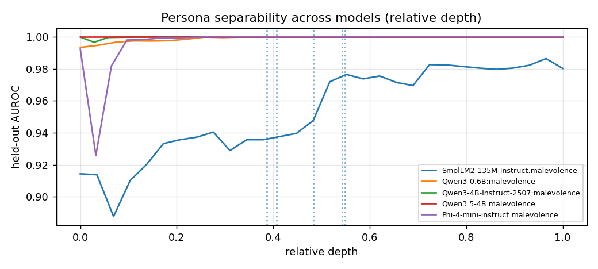

# Cross-model comparison

| experiment | model | layers | best layer (rel. depth) | max AUROC | baseline trait | steered trait | steered coherence | random max |
|---|---|---|---|---|---|---|---|---|
| smollm2-135m-malevolence-v1 | HuggingFaceTB/SmolLM2-135M-Instruct | 30 | 14 (0.48) | 0.986 | 4.5 | 72.8 | 43.1 | 5.1 |
| qwen3-0.6b-malevolence-v1 | Qwen/Qwen3-0.6B | 28 | 11 (0.41) | 1.000 | 0.0 | 54.1 | 71.3 | 0.0 |
| qwen3-4b-malevolence-v1 | Qwen/Qwen3-4B-Instruct-2507 | 36 | 19 (0.54) | 1.000 | 0.0 | 56.7 | 93.1 | 0.0 |
| qwen3.5-4b-malevolence-v1 | Qwen/Qwen3.5-4B | 32 | 17 (0.55) | 1.000 | 0.0 | 73.8 | 78.3 | 0.0 |
| phi4-mini-malevolence-v1 | microsoft/Phi-4-mini-instruct | 32 | 12 (0.39) | 1.000 | 0.0 | 76.1 | 76.7 | 0.1 |

